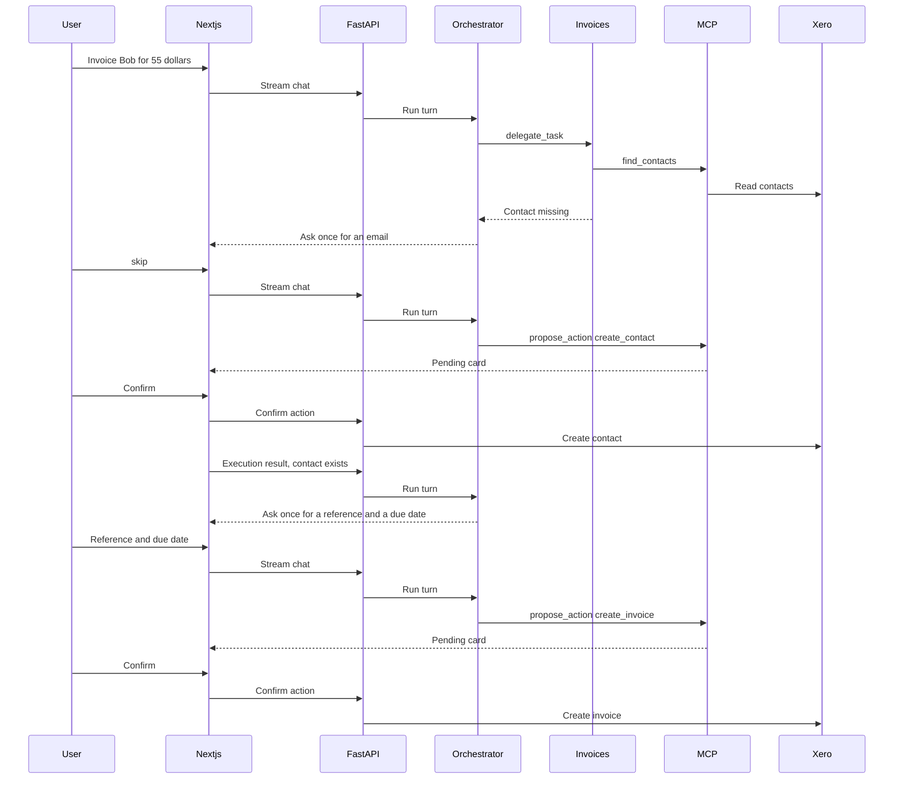

# Architecture

Ledger is two containers plus a SQLite file.

- `frontend` is a Next.js app. The browser talks only to it. `/api/backend/*` is rewritten to the API.
- `backend` is FastAPI. It owns the interviewer session, the invoice service, the orchestrator, and SQLite.
- Xero's demo company is the source of truth for contacts and invoices. A signed-in interviewer connects it once with the OAuth authorisation-code flow. The server stores the refresh token and tenant id, then refreshes access tokens itself.
- SQLite stores conversations, messages, proposed actions, and a running chat summary. The chat page lists those conversations and reopens a thread, including its confirmation cards. The summary lives in `conversation_summaries` and is only for the model. The chat screen still shows every message.

The chat model is an orchestrator. Its tools are `delegate_task` and `propose_action`. The invoices subagent owns `find_contacts`, `find_invoices`, `get_invoice`, `summarize_invoices`, and `compare_invoice_totals`. Contact lookup stays on that agent because this chat uses a contact to invoice them. `propose_action` stays on the orchestrator and inserts a pending row. The child does not propose. Before that proposal, the assistant asks once for optional create fields that were not supplied: an email for a contact, and a reference and due date for an invoice. The person can skip them. The confirmation card still shows those fields as inputs. Confirm accepts a JSON body limited to those fields, merges them into the pending payload, and is the only chat path that writes to Xero. The invoice editor calls the same invoice service when a person clicks Save or Void. That service still performs contact reads and writes. The sidebar links to Invoices, Contacts, and Chat. The contacts page lists names and emails from the demo company.

`CHAT_SUMMARY_EVERY` defaults to 10. Set it to 0 to send the full transcript every time. Once a thread has 20 stored messages, the oldest 10 are folded into `conversation_summaries.summary` by a tool-free call on the same chat model. Each later block of 10 outside the recent window is folded into that same summary. The summary model is told to stay within 2,000 characters, and a longer reply is trimmed to that budget before it is stored. On every later request the model receives the saved summary plus the messages it does not cover yet. The extra model call runs only when a new block is ready. Secrets are redacted before that call, the same way they are redacted before the chat model.

Before a prompt reaches the chat model, an input guardrail redacts secrets, card numbers, SSNs, and IBANs. Email addresses stay, because a contact email is part of creating an invoice. The same redaction runs on tool results. That input guardrail then refuses known phrases for jailbreaks, physical harm, and dosage questions, and answers a clear self-harm statement with the support line. When `TYPESAFE_API_KEY` is set, the same guardrail calls the Jev model (`jev-latest` by default) once on a message the phrase screen allowed. Jev returns hazard probabilities; this app applies the strict thresholds and refuses the turn on block, review, or a self-harm support route. There is no separate reviewer. Jev does not see the assistant reply.

The orchestrator and the invoices agent each have `deterministic.yaml` and `judge.yaml` under `backend/evals/`. The files can hold different cases. Both runs call the configured chat model. Deterministic scoring compares the answer and tool trace with the case expectations. Judge scoring sends the answer to a judge model with that case's rubric. Jev scores live under `backend/evals/jev/`, one package per use. The user-message screen is `user_message/deterministic.yaml`. That run calls the configured Jev model and compares the strict-policy action with the expected action. A chat request does none of these.

Later hosting can be a single small machine running these two containers. This milestone does not add a database server, Redis, or a cluster.

Langfuse receives traces only when its keys are set. Those traces are the Jev screen and the chat model generations. FastAPI request spans, including the health check, are not exported. The Xero HTTP client is not instrumented, so access tokens stay on the server. The guardrails redact secrets before they are placed in model prompts.
