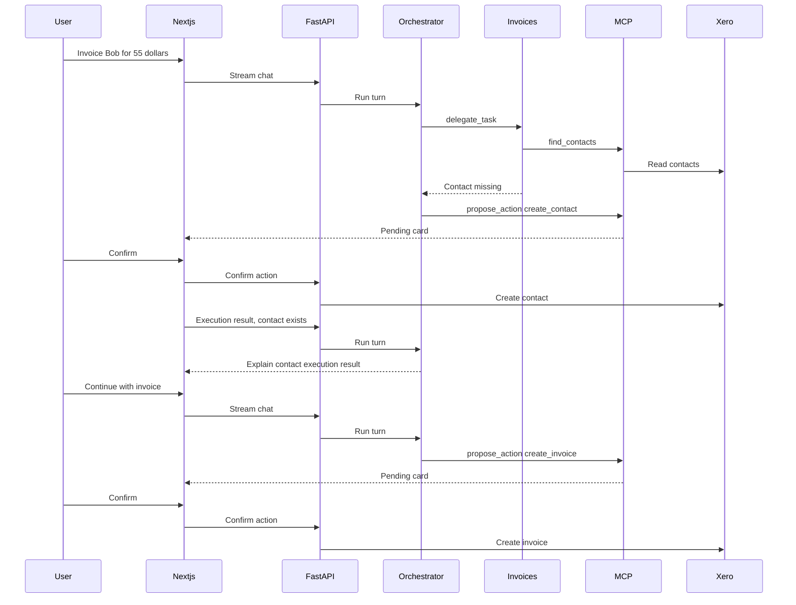

# Architecture

## Read-only performance reports

The Performance route follows browser → Next.js `/api/backend` proxy → authenticated FastAPI `/reports/profit-and-loss` → report module → Xero. It does not use the invoice-total calculator or the write/proposal path. The reports module owns organisation currency/timezone metadata, explicit date resolution, normalization and source-row keys. Account identities remain private inside typed results and are excluded from HTTP serialization.

`PERFORMANCE_REPORTS_ENABLED` gates reads and defaults off. Report scopes require renewed OAuth consent and user permission; connection status is insufficient. One operation encloses organisation and report reads in `REPORT_TIMEOUT_SECONDS` (default 30). The Xero client's separate `get_bounded` path streams and caps decoded bytes before JSON parsing, including compressed responses, while existing invoice/contact reads retain their behavior. Reports are limited to 1 MiB decoded content and 500 account rows. Malformed or unsupported data fails closed; explicitly empty data is distinct from zero profit. No report bodies are stored, logged, traced or sent to model providers by this page. No report path mutates accounting records.

The report views preserve source hierarchy and decimal strings with metadata, native section disclosure, explicit refresh and stale-response protection. Supported English standard report headings are verified against request dates. Base-currency precision and Windows-to-IANA timezone mappings are explicit policies; unsupported values do not silently inherit defaults. Human QA verifies live permission, dates/basis and source values against Xero before enabling the flag. AI explanation is a subsequent slice.

`GET /reports/profit-and-loss/comparison` reads organisation metadata once and two explicit report ranges under one operation deadline. The comparison module classifies supported standard income/expense sections, validates leaf/subtotal/profit relationships, and aligns accounts by private identities. Summary rows validate source math but never become contributors. Decimal arithmetic uses a 50-digit local context; output retains reported precision with currency-minimum padding. Only after complete validation can a missing account become zero; an empty report produces an explicit empty comparison without metrics. Account reclassification across income/expenses is unsupported, as are unbound/unknown financial totals. Top-five signed contributors plus the remainder reconcile to net-profit change within currency tolerance. Zero/negative percentage baselines are labelled unavailable.

Period resolution is separate from financial math: default completed months use organisation time, whole-month previous-period comparisons use calendar months, custom-length previous periods use equal inclusive day counts, and previous-year dates clamp leap day. Custom ranges require all dates; partial/future/reversed/identical ranges are rejected before report reads. The frontend holds unapplied draft dates independently from resolved result metadata, ignores superseded requests, and preserves edits made during a pending read. Evidence references use report-prefixed public keys, open closed source disclosures, and focus the exact original row. No report data or generated narrative is added to chat in this slice.

`GET /reports/balance-sheet/comparison` has a separate typed as-of query and position result. Both report interfaces reject unknown query fields, preventing position dates from being silently ignored as P&L defaults or vice versa. Balance sheets use one metadata GET and two explicit `periods=0` report GETs under the same deadline. Row normalization shares bounded identity/decimal extraction, while financial validation is report-specific: supported asset/liability/equity sections, local subtotals, global totals, net assets and the accounting identity must reconcile. Only validated positions can zero-fill an absent account. Account category changes are unsupported. The shared amounts module keeps precision and percentage policy identical across reports, but position movements have no profit-contribution field. Separate frontend explorers use as-of versus range controls, share evidence disclosure, cancel on tab changes, and keep exact date/currency/retrieval metadata visible.

Ledger is two containers plus a SQLite file. Local development runs through Docker Compose directly on Ubuntu. Source directories are bind-mounted, and SQLite persists in the local `assistant-data` named volume. Rebuilding images preserves volumes; transferring the repository to a new computer requires a separate database backup/restore to retain saved conversations and the Xero connection.

- `frontend` is a Next.js app. The browser talks only to it. `/api/backend/*` is rewritten to the API.
- `backend` is FastAPI. It owns the interviewer session, the invoice service, the orchestrator, and SQLite.
- Xero's demo company is the source of truth for contacts and invoices. A signed-in interviewer connects it once with the OAuth authorisation-code flow. The server stores the refresh token and tenant id, then refreshes access tokens itself.
- SQLite stores conversations, messages, proposed actions, and a running chat summary. The chat page lists those conversations and reopens a thread, including its confirmation cards. The summary lives in `conversation_summaries` and is only for the model. The chat screen still shows every message.

The chat model is an orchestrator. Its tools are `delegate_task` and `propose_action`. Each run also receives the server's current ISO date so relative dates such as today and tomorrow are resolved before a proposal reaches the confirmation card. The invoices subagent owns `find_contacts`, `find_invoices`, `get_invoice`, `summarize_invoices`, and `compare_invoice_totals`. Contact lookup stays on that agent because this chat uses a contact to invoice them. `propose_action` stays on the orchestrator and inserts a pending row. The child does not propose. Once required details are known, the assistant proposes immediately, preserving supplied optional fields and omitting missing ones. Contact email, invoice reference, and invoice due date are independently optional. An omitted due date defaults to 14 days from today. Optional fields may be mentioned alongside a required clarification or the proposal, but never cause a separate question. Conversation history resolves follow-ups such as "same contact as last"; an ambiguous contact or missing required line-item detail still requires clarification. The confirmation card shows the optional fields as inputs. Confirm accepts a JSON body limited to those fields, merges them into the pending payload, and is the only chat path that writes to Xero. The invoice editor calls the same invoice service when a person clicks Save or Void. Both entry points use the same exact-decimal validation before data can be stored or written: at most 100 lines, quantities through `99999999.9999` with four decimal places, unit amounts through `999999999999.99` with two decimal places, and a pre-tax subtotal through `999999999999.99`. Non-finite values are rejected. The browser mirrors these limits for early feedback, but FastAPI is authoritative, including for values supplied through chat. The service sends validated decimals to Xero as decimal strings so binary floating-point conversion cannot change them. The sidebar links to Invoices, Contacts, and Chat. The contacts page lists names and emails from the demo company.

`CHAT_SUMMARY_EVERY` defaults to 10. Once a thread has 20 stored messages, the oldest 10 can be folded into `conversation_summaries.summary` by a tool-free call on the same chat model. At most one block is folded per turn by default (`SUMMARY_MAX_BLOCKS`). Summary text is capped at 2,000 characters. The summarizer has a separate per-fold budget of two requests, 4,000 reported tokens, 768 output tokens, and ten seconds. Exceptions, empty output, or a failed save retain the last valid stored summary and do not advance coverage for that failed block. Personal data is protected before summarization and restored only for trusted storage. `CHAT_SUMMARY_EVERY=0` disables folding; it no longer sends unlimited history.

The main model sees the saved summary and a bounded server-owned tail: at most 20 stored messages and 12,000 characters by default, allocated newest first. Truncated context or summary failure adds an explicit instruction to ask for missing details rather than guess contacts, amounts, dates, or execution outcomes. The same turn's tool exchanges remain in model history after its initial replacement. Source messages and pending proposals remain in SQLite; truncation affects only model context.

## AI execution budgets and degraded behavior

The chat deadline starts before request-body decoding and spans all streamed preparation, summary work, screening, parent/child model calls, and tool execution. The default is 60 seconds (`CHAT_TIMEOUT_SECONDS`, maximum 180). Request-scoped state is set inside the stream task and reset with `ExitStack` on success, error, disconnection, or cancellation. Owned OpenAI, Xero, tracing, and database resources close through application lifespan cleanup. Short synchronous CPU/SQLite operations are cooperative rather than forcibly interrupted; redaction preparation runs in a worker thread, whose isolated vault is never reused by another request if cancellation wins.

`TurnBudget` in `chat/execution.py` is authoritative for the agent tree: hooks reserve each model request and tool call before it begins and count each model response's reported tokens. Defaults are 12 requests, 12 tools, and 20,000 total tokens. The invoices child has the same hooks and shares the request-scoped counter; parent capability counters are not inherited a second time. Framework `UsageLimits` are also passed to the adapter. Installed PydanticAI Harness 0.55.0 forwards usage totals but, for unmanaged children, does not forward the parent's limits; scripted regressions cover this distinction. Parent/child loops and validation retries therefore cannot bypass the explicit counters. Total tokens are checked after provider responses; the response crossing the threshold may consume more than the remaining allowance, but its tools are not executed and no further request starts. Each request asks for no more than the remaining allowance or 2,048 output tokens, whichever is smaller; over-budget reported output also fails. These limits are operational guardrails rather than an exact billing ceiling.

Production supports the `openai:` chat provider, using an owned OpenAI SDK client with automatic retries disabled and a 20-second per-request timeout. `AI_PROVIDER_RETRIES=0` is a deliberate fail-fast policy and the only accepted value; no backoff is needed when no provider request is automatically replayed. Application validation retries default to one and are counted in the same model-request budget. The model temperature defaults to zero; set `CHAT_TEMPERATURE=null` for models that do not accept temperature. New user text is limited to 4,000 characters. Typed settings reject invalid values at startup; defaults are shown in `.env.example`.

Summary and Jev work have independent bounds within the same overall deadline. Configured Jev screening gets five seconds, does not auto-retry at the application layer, and fails closed on timeout, provider failure, or malformed output. Screening client creation, calls, and cleanup are bounded; provider-reported token counts and billing are not available through this integration. Summary failure is nonfatal, while an exhausted overall deadline stops the turn.

The stream sanitizes native model errors before protocol conversion. Rate limits, outages, invalid model responses, usage exhaustion, and timeouts produce terminal Vercel error events with recovery guidance. Interrupted protected-token fragments are discarded rather than flushed. Only successfully completed assistant answers are saved. Proposals created before an error remain pending and can be recovered by reopening the conversation. The UI handles error state, releases text-pacing locks, offers cancellation through **Stop reply**, and never treats an interrupted narration as proof of an executed Xero write. A subsequent request is deliberate; there is no automatic turn replay.

Optional traces keep model/tool usage and latency under chat, summary, and guardrail use cases, with SHA-256 prompt-source versions and HMAC conversation identifiers keyed by the session secret. Export is restricted to AI instrumentation and metadata; finished spans are copied with empty events/links, sanitized status, generic operation names, and allowlisted attributes. Prompts, replies, tool bodies, arbitrary metadata, and exception text are excluded, and redaction failures drop the span. Default root sampling is 10% (`TRACE_SAMPLE_RATIO`) with parent-based child sampling. `ENVIRONMENT` is recorded. Billing cost is explicitly unavailable, not zero. Set a 30-day retention policy in the tracing account/deployment before enabling export; remote deletion is not automated by Ledger. Tracing remains optional and tests force it off.

As a chat turn enters the API, Presidio replaces personal data with numbered placeholders such as `[redacted_email:1]`. The same vault is used for the summary model, Jev, the orchestrator, and the invoices agent. Stored messages in `messages.content` keep the original text, and the browser receives the original text again after the reply is restored. Tool arguments are restored immediately before `propose_action` and the invoice read tools run. `delegate_task` keeps the placeholders, so the invoices agent does not see the raw values. Tool results are protected again before either model reads them. Dates and URLs stay as written. API keys and private keys are redacted separately and are not restored. That input guardrail then refuses known phrases for jailbreaks, physical harm, and dosage questions, and answers a clear self-harm statement with the support line. When `TYPESAFE_API_KEY` is set, the same guardrail calls the Jev model (`jev-latest` by default) once on a message the phrase screen allowed. Jev receives the protected latest prompt and at most the two immediately preceding stored user or assistant messages from the same conversation. Historical message content has a combined 4,000-character budget, allocated to the newest message first and then to the older message; content within a partially kept message is retained from its beginning. Jev is explicitly told to classify the latest message, use history only to resolve its references, ignore unrelated historical hazards, and still classify adoption or continuation of a historical hazard. This context is request-scoped and reset after the stream, so another conversation cannot inherit it. Jev returns hazard probabilities; this app applies the strict thresholds and refuses the turn on block, review, or a self-harm support route. There is no separate reviewer. Jev uses preceding assistant text only as context; it does not grade the new assistant reply.

The orchestrator and the invoices agent each have `deterministic.yaml` and `judge.yaml` under `backend/evals/`. The files can hold different cases. Both runs call the configured chat model. Deterministic scoring compares the answer and tool trace with the case expectations. Judge scoring uses the configured chat model with each case's rubric, and retains mechanical unconfirmed-write checks; orchestrator judges also require pending-proposal evidence. Jev scores live under `backend/evals/jev/`, one package per use. The user-message screen is `user_message/deterministic.yaml`; each case has a latest prompt and may include the same bounded conversation tail used in chat. The eval creates a request-scoped personal-data vault and uses the same prompt-and-history protection helper as production before calling Jev. That run compares the strict-policy action with the expected action. A chat request does none of these.

Evaluation runners require explicit live opt-in (`--live` or `live=True`); pytest requires `--live-evals` for marked paid tests. Default tests block real model requests and HTTPX transports while preserving scripted models and mock transports. A shared report validator matches the exact selected case names, requires nonempty all-true assertions, and rejects task failures, case evaluator failures, and report evaluator failures. Pydantic Evals stores failed assertions separately from execution exceptions, so inspecting `report.failures` alone cannot prove success.

Live evaluation concurrency is two cases, each task has a 90-second deadline, and the entire dataset including judging has a 900-second deadline. Agent tasks have 12-request, 12-tool-call, and 20,000-token limits. Judge and Jev token usage is not included in that task budget. Local git-ignored artifacts allowlist only case identifiers, assertion booleans, task and total latency, task usage, configured/observed models, framework version, and SHA-256 dataset/prompt-source versions. No case inputs, outputs, evaluator reasons, or exception bodies are persisted. Billing cost and judge/Jev usage are explicitly unavailable. Model aliases are documented as mutable; use snapshot configuration for comparable runs. Retention is manual deletion after 30 days. No live results are claimed by offline verification.

Later hosting can be a single small machine running these two containers. This milestone does not add a database server, Redis, or a cluster.

## Durable write execution and recovery

Chat confirmations and invoice-editor mutations share the actions execution service. A conditional SQLite update claims `pending` as `executing` and freezes the validated payload plus confirmation edits in one transaction. No database transaction stays open while calling Xero. Denial can only claim `pending` as `denied`. Completion can only transition `executing` to `executed`, `failed`, or `unknown`. Completed confirmations return the recorded result; competing or repeated requests cannot invoke the gateway again.

Editor writes accept `X-Write-Id`, a UUID for one intentional operation. The id is bound to the action type and validated payload. Reuse for different input is rejected. The browser stores a SHA-256 request fingerprint and UUID in tab-scoped session storage, retaining it across lost responses and reloads. Raw request bodies are not stored there; a fingerprint is not encryption and low-entropy inputs can be guessed. A reliable success or rejection releases the browser id for a later intentional write. Callers that omit the header are treated as starting new writes and must supply their own stable ids to obtain retry deduplication. Receipts live in the existing `proposed_actions` table under a message-free internal conversation; the chat list excludes threads without messages. No table or column migration is needed, and existing database contents remain valid.

Each action uses a stable Xero `Idempotency-Key` derived from its receipt id. Accounting GETs and identical keyed POSTs have at most three HTTP attempts, with 0.25/0.5-second backoff. Numeric `Retry-After` values up to two seconds are honored; longer or unrecognized cooldowns stop retries instead of retrying early. Writes are additionally bounded by `ACTION_EXECUTION_TIMEOUT_SECONDS` (120 by default, maximum 240). [Xero documents a six-minute key lifetime](https://developer.xero.com/documentation/guides/idempotent-requests/idempotency/); local receipts are retained and never replayed externally after a final or uncertain outcome. Retries happen only inside the original execution, with the same key and request body. OAuth code exchanges and refresh grants are never automatically replayed, and refresh-token rotation is serialized within this API process.

Transport failures, malformed responses, and ambiguous server errors after a write are reported as `unknown`, with sanitized HTTP errors and no automatic retry recommendation. Interruption and deadline expiry also quarantine the action. If Xero succeeds but saving its result fails, the existing executing claim remains durable. Reading a receipt or reopening its chat quarantines an executing claim older than the configured deadline plus 60 seconds as `unknown`. A server restart therefore cannot silently reopen an abandoned write. This assumes the current single API process; there is no distributed worker recovery service.

Recovery is deliberately manual: use a read-only receipt status check, then inspect the contact or invoice in Xero. Verify whether the intended fields and values were applied. If a write occurred, do not issue another create. If absence or rejection is established, submit a new intentional action with human confirmation. The application does not automatically reconcile or release unknown receipts, because a generic lookup cannot reliably prove which create request produced a record. UI status checks never mutate Xero. HTTP clients and the SQLite engine are released by application lifespan cleanup.

## Partial invoice editing

The frontend compares its draft to the loaded server snapshot and submits only changed contact/reference/date fields. An omitted or null reference leaves it unchanged; an empty string clears it. Omitted or null due dates leave the date unchanged. The editor explicitly refuses a due-date clear because this workflow does not establish safe removal semantics for Xero invoices. An unchanged form emits no write. A successful response replaces the form snapshot, including values normalized by Xero. Route identity plus a generation guard prevents old load/save/void responses from populating another navigation to an invoice.

Line updates are complete replacement lists with typed existing `line_item_id` UUIDs and explicit `removed_line_item_ids`. Every original line must be kept by its identity or named as removed, and every identity must belong to the fresh invoice fetched during execution. This allows intentional addition, removal, reordering, and full replacement without guessing by position or description. Metadata-only writes omit `LineItems` entirely. For line edits the server merges editable description/quantity/unit-price values with the current account, tax, tracking, item, discount, and explicit tax amount fields. Only new lines use creation defaults. The original `LineAmountTypes` is retained; computed line totals are recalculated by Xero. See [Xero's invoice API](https://developer.xero.com/documentation/api/accounting/invoices) for line identities and amount conventions.

The HTTP editor receives line identities and capability flags. Ordinary model tool serialization still excludes them and raw accounting metadata. Chat line replacements use original_line selectors containing the exact original description, quantity, and unit_amount, and removed_lines for explicit removals. The server fetches the invoice and deterministically resolves unique matches to private ids before storing the proposal. Missing, changed, or duplicate matches fail before proposal; every existing line must be retained or explicitly removed. Provider-history copies exclude receipt and line ids while UI events retain routing data. Confirmation narration allowlists status, invoice number, total/currency, or a short contact name, remains within 256 characters, and omits full payloads, ids, and error diagnostics. Unsupported line fields, out-of-limit values, missing/duplicate ids, or simultaneous nonzero percentage and amount discounts disable line editing while allowing metadata changes. Amount changes on a line exposing `TaxAmount` are rejected even if it could be calculated tax: the API response does not identify override intent, so resending that amount after changing quantity or price could corrupt the tax calculation. Descriptions can still change with the original explicit tax amount retained. No new database schema is required.

Orchestrator evals also accept typed conversation inputs with a latest prompt and prior user/assistant messages. The same-contact regression uses real model message history. One request-scoped personal-data vault protects the entire input and scored output; traces contain only new tool calls and results. Optional-field cases check proposal behavior without requiring a separate skip turn. Eval model usage is bounded and orchestrator cases have a wall-clock timeout.

The vault masks already known exact values before running fresh entity detection. Before every parent and child model request, a history processor protects a copy of the messages with that vault, including structured tool arguments and results. A name detected in an isolated lookup result therefore also uses its token in earlier prompt text on the next request. Word boundaries prevent a known short name from replacing part of a distinct longer name. This does not merge aliases or remove the need to clarify genuinely ambiguous contacts, and stored originals remain unchanged. Expected pending proposals in judge cases are also checked mechanically against the current-turn trace so a judge false positive cannot hide a missing proposal.

Langfuse receives traces only when its keys are set. Those traces are the Jev screen and the chat model generations. FastAPI request spans, including the health check, are not exported. The Xero HTTP client is not instrumented, so access tokens stay on the server. Personal data is replaced with placeholders before it is placed in model prompts.

## Financial read contract (Phase 5)

`InvoiceReadResult` carries records plus completeness determined before local filtering. Xero invoice reads keep 20 pages of 100 records. A full twentieth page triggers one additional page whose records are not retained: an empty page establishes an exact-cap complete read; any records establish truncation. Short earlier pages establish below-cap completeness. Comparisons query each period separately, requiring both to be complete before combining records by unique sales invoice number. This excludes irrelevant gap dates and deduplicates overlaps; each period is capped at 2,000 records (at most 4,000 retained before deduplication), and identical ranges reuse one read. Requests explicitly set page size and stable invoice-ID ordering, filter sales invoices (`ACCREC`), and apply status and issue-date conditions in Xero. Contact substring searches resolve bounded, paged matching contact IDs, applied through Xero's `ContactIDs` parameter before invoice paging; more than 100 matching contacts requires a narrower name to bound request size. Contact truncation fails closed rather than proving absence. See [Xero's invoice filters](https://developer.xero.com/documentation/api/accounting/invoices) and [paged-resource behavior](https://developer.xero.com/documentation/api/accounting/requests-and-responses/).

Invoice list HTTP responses expose schema_version `2`, `complete`, `scanned_count` (retained rows before local filters), `limit` (2,000), and nullable `next_step`. The list MCP tool adds `ok`. Incomplete lists can show individual records but cannot establish totals or absence, including when post-filtering returns zero records. Summary/comparison services require complete reads and otherwise return a sanitized non-retryable error recommending narrower filters, without amounts. Contact and aggregate failures reach both HTTP and MCP callers. Malformed page envelopes cannot be treated as empty pages. Reversed ranges fail before reads; HTTP validation returns 422, service/MCP failures retain the shared error contract. Page-by-page reads are not a transactional Xero snapshot: concurrent upstream changes can affect a report; no exactly consistent historical snapshot is claimed.

Typed v2 summary/comparison contracts remove scalar monetary totals from the top level. Summaries retain overall invoice/unpaid/overdue counts and expose per-currency counts and monetary values under `currencies`. Comparisons use the union of currencies on recognised (authorised or paid) invoices within either inclusive period, zero-fill the absent period, and compute `difference = period_b_total - period_a_total` within each currency. Currency groups sort by code. Empty groups do not imply an organisation currency; missing/invalid invoice currency prevents aggregation. No conversion or cross-currency sum is available. The UI displays each code with every amount, suppresses unavailable totals, labels partial lists and ignores late requests for previous filters.

MCP tools advertise typed success/error output unions and schema `2` in their descriptions. FastMCP wraps these union structured outputs in a `result` object; the inner success includes schema_version, and failures include the ordinary `ok=false` error shape. HTTP outputs remain unwrapped. Prompt-source hashes change automatically with the currency/completeness instructions. Invoice evaluation cases use isolated synthetic per-case gateways, with separate deterministic and judge datasets. New deterministic cases check currency-labelled amounts, prohibit a combined 200 in the mixed fixture, and test empty/truncated wording using answer text rather than appended tool JSON. These lexical checks supplement pure math and contract regressions; they do not guarantee every possible model wording. Paid runs remain opt-in. No persistence migration, Xero write, or extra service is needed.

## Context-bound report explanations

Performance comparisons issue short-lived signed selectors: public report type/dates/nonce plus HMAC bindings of trusted tenant and private account identity. Account IDs are neither encoded in browser/model tokens nor looked up by the positional movement key after refresh. `reports/context.py` validates signature, age and tenant, calls the shared app-level ReportService, verifies no reconnect occurred, and requires exactly one identity match. `/reports/explanation-source` performs the same refetch before returning current source keys. ReportService shares rate/deadline/byte/row limits across callers; `current_read_tenant` prevents mixed-tenant GETs during OAuth reconnect. Token-decorated comparison results have an additional configurable byte cap.

`POST /chat` with explicit top-level `report_context` selects an isolated report workflow. It ignores prior chat history, refetches all evidence and binds request-local `ReportFacts`. The parent orchestrator's report MCP tools are separate from the invoice child: ordinary chat receives only a typed value-free Performance navigation action, while the report agent receives bounded protected labels/keys/directions. The report agent has no invoice, proposal or write tools. Its strict `ReportFactSelection` permits focus enums and supplied evidence keys only. Unlike ordinary string streaming, report-mode model output is privately buffered and validated; no model prose or partial structured output reaches the UI. The deterministic renderer substitutes exact trusted values, recomputes a remainder for the accounts actually displayed, gives refreshable relative source links, timestamps and a mandatory cause-unknown limitation. Position changes remain distinct from profit contributions/cash flows.

The frontend prepares an editable session-storage draft and signed token, navigates to chat, and waits for explicit submission. ReportText renders only the exact internal evidence URL syntax; arbitrary model Markdown URLs remain text. The source view resolves signed identity before focusing returned source rows. Leaving report context restores ordinary chat; app-rendered report envelopes are removed before ordinary model/summary processing, and persisted report assistant messages are value-free refresh notices. No raw report snapshots, financial model tool history, or raw report data are persisted or traced. Reopening a thread therefore asks for a fresh Performance selection.

Separate model/prompt/guard settings and a narration-off default support gradual rollout. PII/secret policy and request-local vaults are reused; protected labels are deterministically screened and, when configured, screened by pinned Jev before model work. Limits/provider/validation/guard failures render deterministic evidence if retrieval succeeded, otherwise sanitized recovery guidance. Model/label-screen spans contain only versions, pseudonymous identifiers, outcome, bounded usage/timing and unavailable-cost metadata. Existing sampling/retention applies. Report goldens are offline CI checks; the separate opt-in paid judge runner never executes from a request. README records snapshot availability, provider retention limits and release/rollback procedures.
