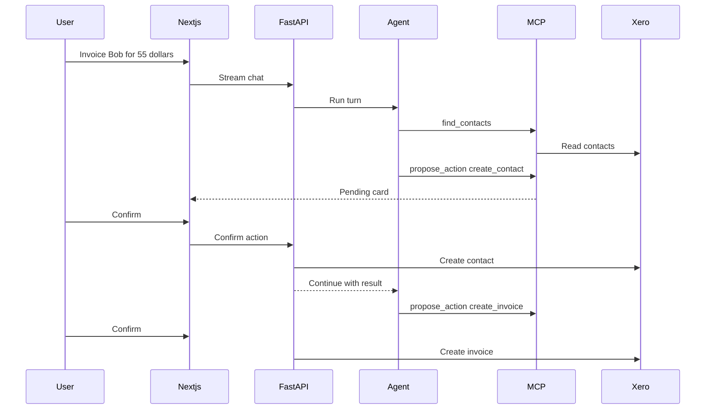

# Architecture

Ledger is two containers plus a SQLite file.

- `frontend` is a Next.js app. The browser talks only to it. `/api/backend/*` is rewritten to the API.
- `backend` is FastAPI. It owns the interviewer session, the invoice service, the chat agent, and SQLite.
- Xero's demo company is the source of truth for contacts and invoices. A signed-in interviewer connects it once with the OAuth authorisation-code flow. The server stores the refresh token and tenant id, then refreshes access tokens itself.
- SQLite stores conversations, messages, and proposed actions.

Each MCP tool lives in its own module under a domain folder in `backend/app/mcp_server/tools/`: `contacts/`, `invoices/`, and `actions/`. The model can call `find_contacts`, `find_invoices`, `get_invoice`, `summarize_invoices`, `compare_invoice_totals`, and `propose_action`. `propose_action` inserts a pending row. Before that proposal, the assistant asks once for optional create fields that were not supplied: an email for a contact, and a reference and due date for an invoice. The person can skip them. The confirmation card still shows those fields as inputs. Confirm accepts a JSON body limited to those fields, merges them into the pending payload, and is the only chat path that writes to Xero. The invoice editor calls the same invoice service when a person clicks Save or Void. That service still performs contact reads and writes. The sidebar links to Invoices, Contacts, and Chat. The contacts page lists names and emails from the demo company.

Before a prompt reaches the chat model, an input guardrail redacts secrets, card numbers, SSNs, and IBANs. Email addresses stay, because a contact email is part of creating an invoice. The same redaction runs on tool results. When `TYPESAFE_API_KEY` is set, that same input guardrail then calls the Jev model (`jev-latest` by default) once on the user message. Jev returns hazard probabilities; this app applies the strict thresholds and refuses the turn on block, review, or a self-harm support route. There is no separate reviewer. Jev does not see the assistant reply.

`backend/evals/invoice_golden.yaml` is the golden dataset. Each case has its own LLM-as-a-judge rubric, and the dataset also carries a G-Eval rubric. Shared checks require a string answer and reject a claim that Xero was changed unless the case already includes an execution result. `pytest` runs those shared checks offline. The model judges run only when you explicitly run the eval command with a real `OPENAI_API_KEY`.

Later hosting can be a single small machine running these two containers. This milestone does not add a database server, Redis, or a cluster.

Langfuse receives traces only when its keys are set. The Xero HTTP client is not instrumented, so access tokens stay on the server. The guardrails redact secrets before they are placed in model prompts.
