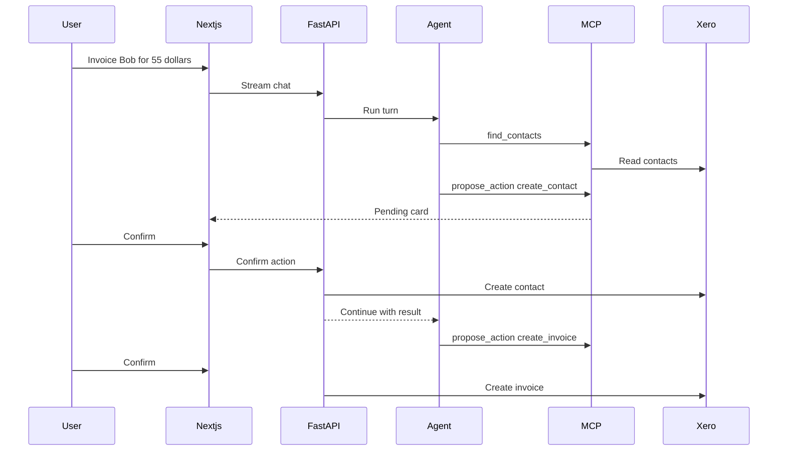

# Architecture

Ledger is two containers plus a SQLite file.

- `frontend` is a Next.js app. The browser talks only to it. `/api/backend/*` is rewritten to the API.
- `backend` is FastAPI. It owns the interviewer session, the invoice service, the chat agent, and SQLite.
- Xero's demo company is the source of truth for contacts and invoices. A custom connection uses the client-credentials grant, so interviewers never connect a Xero organisation.
- SQLite stores conversations, messages, and proposed actions.

The model can call `find_contacts`, `find_invoices`, `get_invoice`, `summarize_invoices`, `compare_invoice_totals`, and `propose_action`. `propose_action` inserts a pending row. The confirm route is the only chat path that writes to Xero. The invoice editor calls the same invoice service when a person clicks Save or Void.

Later hosting can be a single small machine running these two containers. This milestone does not add a database server, Redis, or a cluster.

Langfuse receives traces only when its keys are set. The Xero HTTP client is not instrumented, so access tokens stay on the server.
