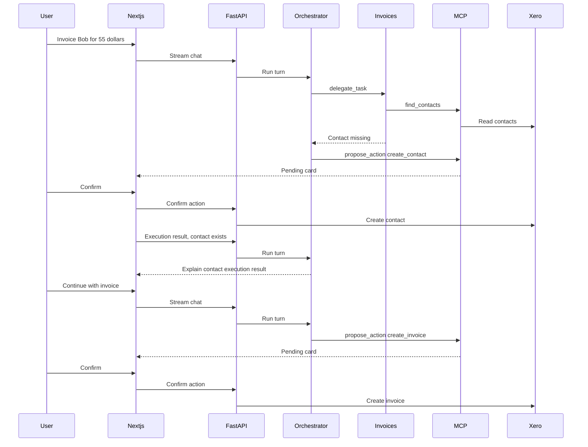

# Architecture

Ledger is two containers plus a SQLite file.

- `frontend` is a Next.js app. The browser talks only to it. `/api/backend/*` is rewritten to the API.
- `backend` is FastAPI. It owns the interviewer session, the invoice service, the orchestrator, and SQLite.
- Xero's demo company is the source of truth for contacts and invoices. A signed-in interviewer connects it once with the OAuth authorisation-code flow. The server stores the refresh token and tenant id, then refreshes access tokens itself.
- SQLite stores conversations, messages, proposed actions, and a running chat summary. The chat page lists those conversations and reopens a thread, including its confirmation cards. The summary lives in `conversation_summaries` and is only for the model. The chat screen still shows every message.

The chat model is an orchestrator. Its tools are `delegate_task` and `propose_action`. Each run also receives the server's current ISO date so relative dates such as today and tomorrow are resolved before a proposal reaches the confirmation card. The invoices subagent owns `find_contacts`, `find_invoices`, `get_invoice`, `summarize_invoices`, and `compare_invoice_totals`. Contact lookup stays on that agent because this chat uses a contact to invoice them. `propose_action` stays on the orchestrator and inserts a pending row. The child does not propose. Once required details are known, the assistant proposes immediately, preserving supplied optional fields and omitting missing ones. Contact email, invoice reference, and invoice due date are independently optional. An omitted due date defaults to 14 days from today. Optional fields may be mentioned alongside a required clarification or the proposal, but never cause a separate question. Conversation history resolves follow-ups such as "same contact as last"; an ambiguous contact or missing required line-item detail still requires clarification. The confirmation card shows the optional fields as inputs. Confirm accepts a JSON body limited to those fields, merges them into the pending payload, and is the only chat path that writes to Xero. The invoice editor calls the same invoice service when a person clicks Save or Void. Both entry points use the same exact-decimal validation before data can be stored or written: at most 100 lines, quantities through `99999999.9999` with four decimal places, unit amounts through `999999999999.99` with two decimal places, and a pre-tax subtotal through `999999999999.99`. Non-finite values are rejected. The browser mirrors these limits for early feedback, but FastAPI is authoritative, including for values supplied through chat. The service sends validated decimals to Xero as decimal strings so binary floating-point conversion cannot change them. The sidebar links to Invoices, Contacts, and Chat. The contacts page lists names and emails from the demo company.

`CHAT_SUMMARY_EVERY` defaults to 10. Set it to 0 to send the full transcript every time. Once a thread has 20 stored messages, the oldest 10 are folded into `conversation_summaries.summary` by a tool-free call on the same chat model. Each later block of 10 outside the recent window is folded into that same summary. The summary model is told to stay within 2,000 characters, and a longer reply is trimmed to that budget before it is stored. On every later request the model receives the saved summary plus the messages it does not cover yet. The extra model call runs only when a new block is ready. Personal data in that call is replaced with the same placeholders used for the chat model, and the stored summary keeps the original values.

As a chat turn enters the API, Presidio replaces personal data with numbered placeholders such as `[redacted_email:1]`. The same vault is used for the summary model, Jev, the orchestrator, and the invoices agent. Stored messages in `messages.content` keep the original text, and the browser receives the original text again after the reply is restored. Tool arguments are restored immediately before `propose_action` and the invoice read tools run. `delegate_task` keeps the placeholders, so the invoices agent does not see the raw values. Tool results are protected again before either model reads them. Dates and URLs stay as written. API keys and private keys are redacted separately and are not restored. That input guardrail then refuses known phrases for jailbreaks, physical harm, and dosage questions, and answers a clear self-harm statement with the support line. When `TYPESAFE_API_KEY` is set, the same guardrail calls the Jev model (`jev-latest` by default) once on a message the phrase screen allowed. Jev receives the protected latest prompt and at most the two immediately preceding stored user or assistant messages from the same conversation. Historical message content has a combined 4,000-character budget, allocated to the newest message first and then to the older message; content within a partially kept message is retained from its beginning. Jev is explicitly told to classify the latest message, use history only to resolve its references, ignore unrelated historical hazards, and still classify adoption or continuation of a historical hazard. This context is request-scoped and reset after the stream, so another conversation cannot inherit it. Jev returns hazard probabilities; this app applies the strict thresholds and refuses the turn on block, review, or a self-harm support route. There is no separate reviewer. Jev uses preceding assistant text only as context; it does not grade the new assistant reply.

The orchestrator and the invoices agent each have `deterministic.yaml` and `judge.yaml` under `backend/evals/`. The files can hold different cases. Both runs call the configured chat model. Deterministic scoring compares the answer and tool trace with the case expectations. Judge scoring sends the answer to a judge model with that case's rubric. Jev scores live under `backend/evals/jev/`, one package per use. The user-message screen is `user_message/deterministic.yaml`; each case has a latest prompt and may include the same bounded conversation tail used in chat. The eval creates a request-scoped personal-data vault and uses the same prompt-and-history protection helper as production before calling Jev. That run compares the strict-policy action with the expected action. A chat request does none of these.

Later hosting can be a single small machine running these two containers. This milestone does not add a database server, Redis, or a cluster.

Orchestrator evals also accept typed conversation inputs with a latest prompt and prior user/assistant messages. The same-contact regression uses real model message history. One request-scoped personal-data vault protects the entire input and scored output; traces contain only new tool calls and results. Optional-field cases check proposal behavior without requiring a separate skip turn. Eval model usage is bounded and orchestrator cases have a wall-clock timeout.

The vault masks already known exact values before running fresh entity detection. Before every parent and child model request, a history processor protects a copy of the messages with that vault, including structured tool arguments and results. A name detected in an isolated lookup result therefore also uses its token in earlier prompt text on the next request. Word boundaries prevent a known short name from replacing part of a distinct longer name. This does not merge aliases or remove the need to clarify genuinely ambiguous contacts, and stored originals remain unchanged. Expected pending proposals in judge cases are also checked mechanically against the current-turn trace so a judge false positive cannot hide a missing proposal.

Langfuse receives traces only when its keys are set. Those traces are the Jev screen and the chat model generations. FastAPI request spans, including the health check, are not exported. The Xero HTTP client is not instrumented, so access tokens stay on the server. Personal data is replaced with placeholders before it is placed in model prompts.
